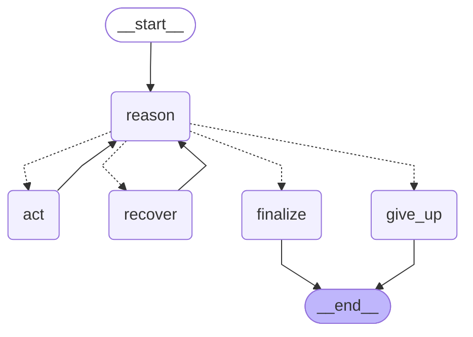

# The ReAct loop as a LangGraph graph (Stage 4)

Exported from the compiled graph in `echonest_agent/graph.py` with `agent.graph.get_graph().draw_mermaid()`
(LangGraph 1.2.15). Solid arrows are fixed edges; dotted arrows are the conditional edge `route_after_reason`, which
decides from the parsed reply whether the model asked for an action.

| Node | What it does |
|---|---|
| `reason` | One LLM call (system prompt + chat history + this turn's scratchpad, `stop=["Observation:"]`), then `parse_react()` on the reply. |
| `act` | Runs the requested tool with `tools.safe_execute()`; the step and its `Observation: ...` are added to the scratchpad. |
| `recover` | The reply broke the text format: the reply and an `Observation: FORMAT ERROR: ...` correction are added to the scratchpad (once per turn). |
| `finalize` | Returns the `Final Answer` (or, after a second format error, the model's plain prose as `format_fallback`). |
| `give_up` | Step budget used up or repeated invalid steps: logs the question with `record_feedback` and apologises. |

`route_after_reason`: `final` → `finalize`; budget used up → `give_up`; `action` → `act`; first format error →
`recover`; plain prose twice → `finalize`; otherwise → `give_up`.

**Scratchpad layout.** This turn's steps go back to the model as one assistant turn (each step followed by its
Observation, the classic ReAct transcript), then a short user message asking for the next step. The first live run,
which put each Observation in its own user message, made `gemini-3.5-flash-lite` return empty `MALFORMED_RESPONSE`
replies for most lookups (5/12 cases passed; traces in
`evidence/stage4_live_traces_run1_separate_observations.jsonl`).
